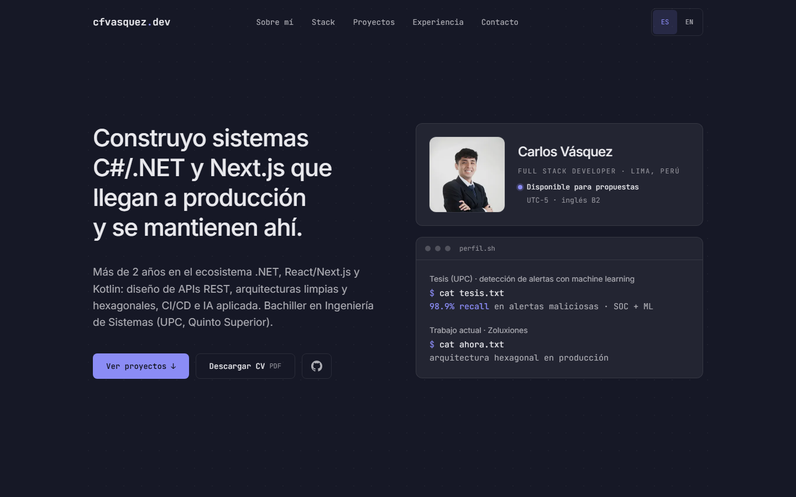
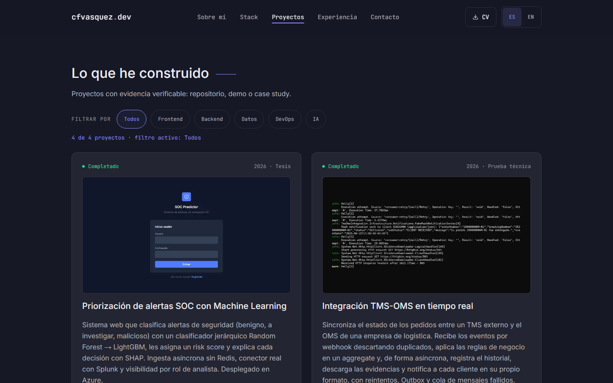

# Carlos Vásquez — Portfolio

> Personal portfolio built with Next.js 16 (App Router): projects with verifiable evidence, a bilingual case study, and a contact form that actually delivers the email.





[](https://www.cfvasquez.dev)

---

## 🧩 Problem / Context

A portfolio to show my work as a Full Stack Developer (.NET, React/Next.js). The rule for every claim on the site is that it has to be verifiable: each project links to its repository, a demo or a case study, and metrics only appear when they were actually measured (e.g. the thesis results). It replaces a static résumé with something a recruiter can check in a couple of clicks, and a contact channel that doesn't depend on the visitor's mail client.

---

## 🛠️ Stack

| Layer           | Technology                                                 |
| --------------- | ---------------------------------------------------------- |
| Frontend        | Next.js 16 (App Router), React 19, TypeScript              |
| Styling         | Tailwind CSS v4, Framer Motion                             |
| i18n            | next-intl (ES/EN, locale stored in a cookie)               |
| Content         | Typed TypeScript modules validated with Zod                |
| Contact         | Route Handler + Resend (real email delivery)               |
| Testing         | Vitest + Testing Library, Playwright                       |
| CI              | GitHub Actions: lint, format, coverage, e2e, Lighthouse CI |
| Analytics       | Vercel Analytics + Speed Insights                          |
| Deploy          | Vercel                                                     |
| Package manager | pnpm                                                       |

---

## 🏗️ Architecture

- **App Router.** `app/page.tsx` assembles one component per section; `app/case-study/[slug]` renders case studies; `app/not-found.tsx` gives unknown URLs the site's own shell.
- **Content as code.** Projects, experience and case studies live in `content/*.ts`, validated by a Zod schema (`content/schema.ts`), so a malformed entry fails the tests instead of rendering broken. No CMS: it's a personal site, updated through pull requests.
- **i18n without routes.** UI strings live in `messages/{es,en}.json`; the locale comes from a cookie set by a Server Action, not from the URL.
- **Contact.** The form posts to `app/api/contact/route.ts`. Validation is a single Zod schema (`lib/contact-schema.ts`) shared by the server and the form: the form uses it to flag each field before sending, and the server stays the final authority.

---

## 🧠 Technical challenges and decisions

- **Problem:** this Next.js version ships breaking changes relative to the docs most people know. → **Solution:** check `node_modules/next/dist/docs` before assuming behavior. → **Example:** Next 16 stopped pausing CSS smooth scrolling on route changes, so opening the case study from mid-page animated a scroll through the new page; `data-scroll-behavior="smooth"` on `<html>` restores the instant jump.
- **Problem:** after a client-side navigation to `/#a`, the next `<Link>` hash navigation produced `/#a#b`, a URL that scrolls nowhere when shared (Next 16.2 appends the hash to a cached canonical URL that already holds one). → **Solution:** on the home page, section links are native `<a href="#id">`; on other routes they're `<Link href="/#id">`. → **Why:** a bare `#id` on `/case-study/*` resolves against the current path and left the whole navbar dead.
- **Problem:** the contact form needed to deliver the message, not depend on the visitor having a mail client configured. → **Solution:** a Route Handler + Resend, with one validation schema for client and server. → **Why:** `mailto:` as the only channel loses messages; per-field errors with focus on the first one let keyboard and screen-reader users fix the form instead of guessing.
- **Problem:** Spanish and English without duplicating pages or maintaining per-language SEO. → **Solution:** next-intl with the locale in a cookie, no `/en` routes; the locale also travels to `/api/contact`, so server errors come back in the visitor's language. → **Why:** people reach a portfolio through a direct link, not organic search, so routed multi-language SEO doesn't pay for itself.
- **Problem:** honesty about the work. → **Solution:** a dev-only "pending" checklist per project in `content/projects.ts` that tracks what still needs evidence; it never renders in production. → **Why:** it kept unverified claims off the site until they were backed by a repo, a demo or a measurement.

---

## 🚀 Running it locally

```bash
git clone https://github.com/Carlou134/portfolio-nextjs.git
cd portfolio-nextjs
pnpm install
pnpm dev
```

Required environment variable (`.env.local`):

```
RESEND_API_KEY=your_resend_api_key
```

Open [http://localhost:3000](http://localhost:3000).

---

## ✅ Code quality

```bash
pnpm lint           # ESLint (next lint was removed in Next.js 16)
pnpm format:check   # Prettier
pnpm test           # Vitest + Testing Library
pnpm test:e2e       # Playwright (reuses a running dev server)
```

- **Unit and component tests** (Vitest): content schema, contact validation and API route, sitemap, and the components where behavior lives: navbar routing, project filter, contact form, case study, 404.
- **End-to-end** (Playwright): contact flow, language switch, the case study in both languages, navigation from the case study, the 404 page, the projects filter, the skip link and reduced motion. Every bug fixed in the redesign has a regression test.
- **CI** (GitHub Actions) runs on every pull request: lint, format check and coverage (also on pushes to `master`), e2e against the production build, and Lighthouse CI.
- **Accessibility:** WCAG AA contrast, a visible focus ring on every interactive element, 44px tap targets, a skip link, a single heading outline per page, and no color-only signals.
